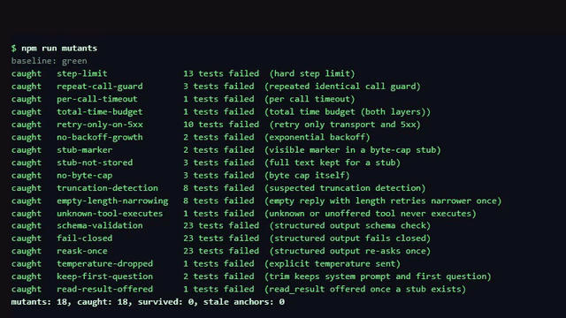

# agent-harness-lab

[](https://github.com/Exalt24/agent-harness-lab/actions/workflows/ci.yml)

A small TypeScript agent harness (tool calling, loop guards, context budget, structured output) with an eval harness that scores a non-deterministic model with confidence intervals.



*A replay of real output from `npm test` (187 of 187 pass) and `npm run mutants` (18 guards removed one at a time, all 18 caught), captured 2026-10-24. [Full quality mp4](docs/demo.mp4).*

## What it is and why

Running agents on small local models fails in quiet ways. A server answers 200 with half the prompt cut. A model drops a tool call. A big tool result is trimmed and the model invents the missing part. This repo is a clean room harness that turns each of those failures into code you can test, plus an eval runner that says how often a model really gets a task right, with an interval, and keeps broken trials out of the score.

The only runtime dependency is `zod`, next to the Node standard library. There is no framework. Node 22.18 or newer runs the TypeScript files directly (type stripping), so there is no build step. TypeScript is used for `npm run typecheck` only.

## The seven lessons and the test that pins each

| # | Lesson | Where it lives | Tests that pin it |
|---|---|---|---|
| 1 | A server can answer 200 after silently cutting the prompt. Compare the prompt token count it reports with what was sent, and report a mismatch. Never swallow it. | `src/loop.ts` (truncation check) | `tests/loop.test.ts` "truncation: ..." (four tests: suspected, fail mode, honest count raises nothing, unreported count is not accused); table and simulation tests with `truncated prompt report` |
| 2 | Sampling temperature is an explicit per model setting. Unset sends nothing, 0 sends 0. The eval measures the difference. | `src/model.ts`, `eval/engine.ts` | `tests/loop.test.ts` "temperature is explicit"; `tests/ollama_client.test.ts` "request: stream false, num_ctx always sent, temperature only when set, 0 is sent as 0" |
| 3 | A tool result over a byte cap becomes head, a visible marker, tail. The full text stays retrievable through `read_result`. A stub is never the only copy. | `src/context.ts` | `tests/context.test.ts` "byte cap: ..." and "read_result: ..."; `tests/loop.test.ts` "byte cap end to end"; the stub invariant in `tests/simulation.test.ts` |
| 4 | Offer fewer tools. The list per turn is narrowable, and a tool that was not offered is refused like an unknown one. | `src/tools.ts` (`rank`), `src/loop.ts` (`toolsPerTurn`) | `tests/loop.test.ts` "narrowing: ..." and "a registered tool that is not offered this turn is rejected"; `tests/tools.test.ts` "registry rank" |
| 5 | An empty reply with `finish_reason: length` is not nudged with a longer prompt. Retry once with narrower tools, same messages. | `src/loop.ts` | `tests/loop.test.ts` "empty reply with finish_reason length: ..." (three tests) |
| 6 | Loop guards: a hard step limit, a repeated identical tool call guard, a total time budget (plus a per call timeout and retries only on transport errors and 5xx, with exponential backoff and jitter). | `src/loop.ts`, `src/retry.ts` | `tests/loop.test.ts` "step limit", "repeat guard", "timeout", "time budget", "retry", "backoff" (each guard has a negative test and a positive control); `tests/table.test.ts` |
| 7 | Structured output is validated against a schema. On failure it is re-asked once with the exact validation error. After that the run fails closed with a reason and returns no data. | `src/structured.ts` | `tests/structured.test.ts` (eight tests); the structured simulation in `tests/simulation.test.ts` |

Every transition of the run (`running`, `tool_pending`, `done`, `failed(reason)`) is written to an event log, and the tests assert on that log.

## How to run

```
npm install
npm run typecheck
npm test                                  # unit, table, simulation tests
npm run mutants                           # remove one guard at a time, the suite must go red
npm run eval:scripted                     # deterministic faults, no model needed
npm run eval:ollama -- qwen3.5:4b         # a real local model through Ollama
```

Useful eval flags: `--trials 10`, `--configs temp0-tools5,temp0-tools24`, `--budget-min 8` (stop cleanly after that many minutes) and `--resume` (continue the same report file). Each run writes a dated JSON report under `eval/reports/`.

### What the checks are

The last full local run (Node 24.18, 2026-10-24) gave these counts.

* `npm test`: 187 tests, all passing. That includes 66 generated table tests (11 fault types by 3 positions by 2 step limits), 20 seeded loop simulations of 50 scripted steps each with random faults, and 20 seeded structured output simulations of 50 requests each.
* `npm run mutants`: 18 mutants, 18 caught, 0 survived, 0 stale anchors. A mutant is one broken guard in a temp copy (step limit, repeat guard, per call timeout, time budget, retry only on 5xx, backoff growth, stub marker, stub store, byte cap, truncation detection, empty reply narrowing, unknown tool execution, schema validation, fail closed, re-ask once, explicit temperature, trim keeps the first question, `read_result` offered). An anchor that no longer matches the source exactly once fails the run, and so does a red baseline.
* `npm run eval:scripted`: 160 trials with seeded faults. It checks the scoring pipeline (PASS, FAIL and ERROR all occur, errors stay out of the denominator). Its rates say nothing about any model.

## How the eval scores

A case is a prompt, the tools a correct run must call, and a check on the final answer. The runner runs N trials per case per configuration (default 10) and reports pass counts with 95 percent Wilson score intervals. A rate is never printed without its interval and counts.

* PASS and FAIL are scored. A wrong answer, a skipped required tool call, a loop on one call and a step limit are FAIL.
* ERROR is a trial that measured nothing about the model: the server failed, a call timed out, a 4xx came back, or the reply was empty. ERROR is counted apart and is never a zero. The denominator is PASS plus FAIL.
* Four configurations cross temperature (unset, which sends no value, against 0) with the tool list (5 tools against 24; the extra tools are named decoys that do nothing).
* Four cases: `arithmetic`, `lookup`, `two-step` (look something up, then calculate) and `cut-result` (the answer sits in the tail of a 12 KB tool result that the harness cut to head and tail). The first three are the tool-choice cases. A correct number without the tool call is a FAIL, because dropped tool calls are what the eval is for.

## Results: qwen3.5:4b on one machine, 2026-10-24

Ollama 0.40.9 on Windows, model `qwen3.5:4b` (4.2B parameters, Q4_K_M), `num_ctx` 8192, thinking off, `stream: false`. "Unset" means no temperature was sent, so the model's own default applied. 0 errors in either run, 0 suspected truncations. Reports: `eval/reports/sample-2026-10-24-ollama-qwen3.5-4b-n10.json` (N=10 per cell, 160 trials) and `eval/reports/sample-2026-10-24-ollama-qwen3.5-4b-n30.json` (N=30 per cell, 480 trials). Every trial and the first 160 characters of its answer are in the files.

Tool-choice cases pooled (arithmetic, lookup, two-step), pass rate with 95% interval:

| Configuration | N=10 per cell (30 trials) | N=30 per cell (90 trials) |
|---|---|---|
| temperature unset, 5 tools | 29/30 = 97% (83% to 99%) | 83/90 = 92% (85% to 96%) |
| temperature 0, 5 tools | 30/30 = 100% (89% to 100%) | 90/90 = 100% (96% to 100%) |
| temperature unset, 24 tools | 25/30 = 83% (66% to 93%) | 78/90 = 87% (78% to 92%) |
| temperature 0, 24 tools | 30/30 = 100% (89% to 100%) | 90/90 = 100% (96% to 100%) |

Per case at N=30 per cell:

| Case | unset, 5 tools | 0, 5 tools | unset, 24 tools | 0, 24 tools |
|---|---|---|---|---|
| arithmetic | 30/30 (89% to 100%) | 30/30 (89% to 100%) | 30/30 (89% to 100%) | 30/30 (89% to 100%) |
| lookup | 30/30 (89% to 100%) | 30/30 (89% to 100%) | 27/30 (74% to 97%) | 30/30 (89% to 100%) |
| two-step | 23/30 (59% to 88%) | 30/30 (89% to 100%) | 21/30 (52% to 83%) | 30/30 (89% to 100%) |
| cut-result | 14/30 (30% to 64%) | 0/30 (0% to 11%) | 10/30 (19% to 51%) | 0/30 (0% to 11%) |

What the numbers say, and what they do not:

* **Temperature (lesson 2) reproduced for tool choice, in part.** With temperature unset, 14 of 180 tool-choice trials failed because a required tool call was never made (4 with 5 tools, 10 with 24). With temperature 0 that happened in 0 of 180. At N=30 the pooled intervals for unset against 0 do not overlap with 24 tools (87% against 100%) and do overlap with 5 tools (92% against 100%). At N=10 every one of those comparisons overlaps, so the first run alone could not have shown it.
* **Fewer tools (lesson 4) did not reproduce on this model.** At temperature 0 the model got every tool-choice trial right with 5 tools and with 24. With temperature unset, 5 tools against 24 gave 92% against 87% with overlapping intervals. The dropped tool call counts (4 against 10) point the expected way but this run cannot separate them.
* **Temperature 0 is not better for everything.** On `cut-result` it scored 0 of 30 in both tool lists, and the answer was identical every time within a list (`7` with 5 tools, `81` with 24 tools, where the last line says `17`). Greedy decoding turned a coin flip into a certain miss. I did not dig into why the model misreads that line, so treat it as an observed behaviour, not an explanation. The harness did its part (the marker is visible, the tail with the answer is intact, the full text is retrievable); the model called `read_result` in 1 of the 120 `cut-result` trials, because it believed it already had the answer.
* The N=10 and N=30 runs are independent, and the same cell moves between them (`two-step`, temperature unset, 5 tools: 9 of 10, then 23 of 30). That spread is why a rate comes with an interval.

## Honest limits

* This is a small harness, not a framework. No streaming, no parallel tool calls, no persistence, no multi agent anything.
* The token count is an estimate (`ceil(chars / 4)`). It is only used to notice a gross mismatch with what the server reports (less than 60 percent of the estimate, with at least 100 estimated tokens) and to decide when to trim. A real tokenizer will disagree, and a server that reports no count is not accused.
* The Ollama numbers come from one machine, one model, one quantization, one day, four small cases and N of 10 and 30. They show a pattern on this setup. They do not rank models, and they do not transfer to other sizes without a rerun (`--ollama <model>` repeats it).
* Truncation is detected, not prevented, and the default is to warn (event plus `warnings`), not to fail. `onTruncation: "fail"` fails the run closed. No truncation happened in the real runs, so the detector is pinned by scripted tests, not by a live truncation.
* Passing a case is a string check on the final answer plus the tool trace. A right answer with a sloppy explanation passes.
* Tested on Node 24.18 locally and on Node 22 in CI (type stripping needs 22.18 or newer). The first CI run on Linux found a real bug that Windows had hidden: the call timeout timer was unref'd, so a hung model call could end the process with no error. The timer is now kept alive and a test runs the hang in its own process.
* P2P networking, remote inference and any cloud model API are not covered.

## Layout

```
src/model.ts       ModelClient, OllamaClient (HTTP, explicit options, AbortSignal timeout), ScriptedModel with faults
src/loop.ts        the agent loop, run state machine, event log, guards
src/retry.ts       retry with exponential backoff and jitter, transport errors and 5xx only
src/context.ts     token estimate, byte cap stub, read_result, trimming that keeps tool call pairs
src/structured.ts  schema checked output, one re-ask, fail closed
src/tools.ts       calculator (no eval), lookup, decoys, registry with ranking and narrowing
eval/              cases, runner, Wilson intervals, dated JSON reports
tests/             node:test suites, table and seeded simulation tests, mutants.mjs
```

## License

MIT, see `LICENSE`.
